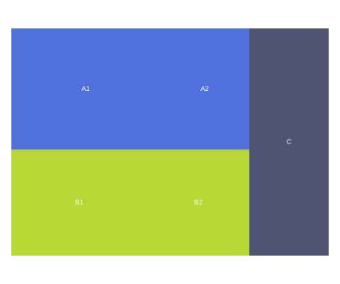
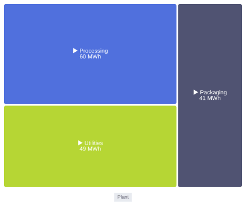
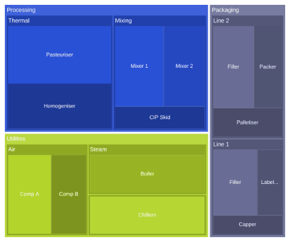
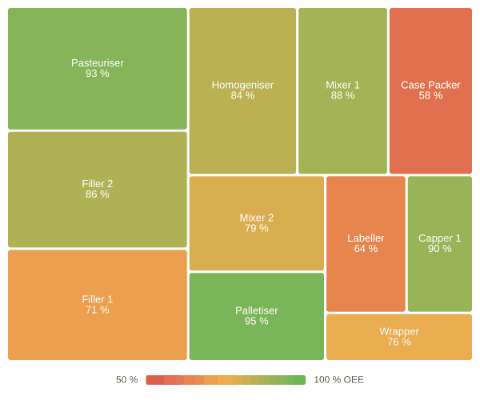

<!-- Generated by web/e2e/wiki.js - do not edit this page. Edit docs/wiki/examples/*.json, docs/wiki/notes/*.md or the generator, then run "npm run wiki" in web/. -->

Treemap area-proportional hierarchy.

| | |
|---|---|
| Component id | `open.echarts.TreemapChart` |
| Palette | **Open Components / ECharts** → **Treemap Chart** |
| Default size | 600 × 500 |



*Treemap Chart as dropped from the palette.* It takes any ECharts option in its `option` prop; the palette entry only decides which sample option a new component starts with.

<details>
<summary>Option of a freshly dropped component</summary>

```json
{
  "series": [
    {
      "type": "treemap",
      "breadcrumb": { "show": false },
      "data": [
        {
          "name": "A",
          "value": 40,
          "children": [{ "name": "A1", "value": 25 }, { "name": "A2", "value": 15 }]
        },
        {
          "name": "B",
          "value": 35,
          "children": [{ "name": "B1", "value": 20 }, { "name": "B2", "value": 15 }]
        },
        { "name": "C", "value": 25 }
      ]
    }
  ]
}
```

</details>

## Examples

- [Drill-down Treemap](#drill-down-treemap): Shows one level at a time; click a block to drill in and use the breadcrumb to go back. Energy use in MWh.
- [Treemap with Parent Labels](#treemap-with-parent-labels): All levels at once: each group has a header strip and its children nested inside, disk-usage style.
- [Heat Treemap](#heat-treemap): Area shows output and colour shows a second measure (OEE %) on a red-to-green gradient.

### Drill-down Treemap

Shows one level at a time; click a block to drill in and use the breadcrumb to go back. Energy use in MWh.



**How to make it in Ignition**

1. In the Designer, drag **Treemap Chart** from the **Open Components / ECharts** group of the Perspective component palette onto a view.
2. Open **Option JSON** below and copy it. In the Property Editor, right-click the `option` property and choose **Paste**: the pasted JSON replaces the sample option. (See [Getting Started](Getting-Started) for other ways to enter an option.)
3. Replace the sample data with live data by binding these paths (expand `option` in the Property Editor down to the property, then use its binding icon). Everything else in the option stays as pasted.

   | Property | The binding must return |
   |---|---|
   | `props.option.series[0].data` | a tree of objects, `{ "name": ..., "value": ..., "children": [...] }` |

   For `series[0].data` build the same structure as the example in a script transform or a project script; [Binding Data](Binding-Data) shows the pattern.

4. Bind `series[0].data` to a tree: `[{name, children: [{name, children: [{name, value}]}]}]`. Parents are sized by the sum of their children.
5. `leafDepth: 1` shows one level at a time; a click drills into a block and the breadcrumb at the bottom goes back. Remove it to show all levels at once.
6. `series[0].name` is the text of the first breadcrumb. Change the unit in `label.formatter` and `tooltip.formatter`.

<details>
<summary>Option JSON</summary>

```json
{
  "tooltip": { "formatter": "{b}: {c} MWh" },
  "series": [
    {
      "type": "treemap",
      "name": "Plant",
      "leafDepth": 1,
      "roam": false,
      "top": 10,
      "left": 10,
      "right": 10,
      "bottom": 44,
      "breadcrumb": { "bottom": 8 },
      "label": { "formatter": "{b}\n{c} MWh", "fontSize": 14 },
      "itemStyle": { "gapWidth": 3, "borderRadius": 4 },
      "levels": [
        { "itemStyle": { "gapWidth": 4 } },
        {
          "colorSaturation": [0.3, 0.6],
          "itemStyle": { "gapWidth": 3, "borderColorSaturation": 0.7 }
        },
        { "colorSaturation": [0.3, 0.5], "itemStyle": { "gapWidth": 2 } }
      ],
      "data": [
        {
          "name": "Processing",
          "children": [
            {
              "name": "Mixing",
              "children": [
                { "name": "Mixer 1", "value": 12 },
                { "name": "Mixer 2", "value": 10 },
                { "name": "CIP Skid", "value": 6 }
              ]
            },
            {
              "name": "Thermal",
              "children": [{ "name": "Pasteuriser", "value": 18 }, { "name": "Homogeniser", "value": 14 }]
            }
          ]
        },
        {
          "name": "Packaging",
          "children": [
            {
              "name": "Line 1",
              "children": [
                { "name": "Filler", "value": 9 },
                { "name": "Capper", "value": 4 },
                { "name": "Labeller", "value": 5 }
              ]
            },
            {
              "name": "Line 2",
              "children": [
                { "name": "Filler", "value": 10 },
                { "name": "Packer", "value": 7 },
                { "name": "Palletiser", "value": 6 }
              ]
            }
          ]
        },
        {
          "name": "Utilities",
          "children": [
            {
              "name": "Air",
              "children": [{ "name": "Comp A", "value": 11 }, { "name": "Comp B", "value": 9 }]
            },
            { "name": "Steam", "children": [{ "name": "Boiler", "value": 16 }] },
            { "name": "Chillers", "value": 13 }
          ]
        }
      ]
    }
  ]
}
```

</details>

### Treemap with Parent Labels

All levels at once: each group has a header strip and its children nested inside, disk-usage style.



**How to make it in Ignition**

1. In the Designer, drag **Treemap Chart** from the **Open Components / ECharts** group of the Perspective component palette onto a view.
2. Open **Option JSON** below and copy it. In the Property Editor, right-click the `option` property and choose **Paste**: the pasted JSON replaces the sample option. (See [Getting Started](Getting-Started) for other ways to enter an option.)
3. Replace the sample data with live data by binding these paths (expand `option` in the Property Editor down to the property, then use its binding icon). Everything else in the option stays as pasted.

   | Property | The binding must return |
   |---|---|
   | `props.option.series[0].data` | a tree of objects, `{ "name": ..., "value": ..., "children": [...] }` |

   For `series[0].data` build the same structure as the example in a script transform or a project script; [Binding Data](Binding-Data) shows the pattern.

4. Bind `series[0].data` to your tree (`{name, value}` leaves, `{name, children}` branches).
5. The header strips are `upperLabel`; their height is `upperLabel.height`. `levels[n]` styles one depth each (index 0 is the whole chart): border and gap widths separate the groups.
6. Blocks smaller than `visibleMin` square pixels are hidden.

<details>
<summary>Option JSON</summary>

```json
{
  "tooltip": { "formatter": "{b}: {c} MWh" },
  "series": [
    {
      "type": "treemap",
      "name": "Plant",
      "roam": false,
      "nodeClick": false,
      "top": 10,
      "left": 10,
      "right": 10,
      "bottom": 10,
      "breadcrumb": { "show": false },
      "visibleMin": 300,
      "label": { "show": true, "formatter": "{b}", "fontSize": 11 },
      "upperLabel": { "show": true, "height": 22, "color": "#fff" },
      "itemStyle": { "borderColor": "#fff" },
      "levels": [
        { "itemStyle": { "borderWidth": 0, "gapWidth": 4 }, "upperLabel": { "show": false } },
        { "itemStyle": { "borderWidth": 4, "gapWidth": 2, "borderColorSaturation": 0.55 } },
        {
          "itemStyle": { "borderWidth": 3, "gapWidth": 1, "borderColorSaturation": 0.4 },
          "colorSaturation": [0.35, 0.5]
        },
        { "colorSaturation": [0.4, 0.7] }
      ],
      "data": [
        {
          "name": "Processing",
          "children": [
            {
              "name": "Mixing",
              "children": [
                { "name": "Mixer 1", "value": 12 },
                { "name": "Mixer 2", "value": 10 },
                { "name": "CIP Skid", "value": 6 }
              ]
            },
            {
              "name": "Thermal",
              "children": [{ "name": "Pasteuriser", "value": 18 }, { "name": "Homogeniser", "value": 14 }]
            }
          ]
        },
        {
          "name": "Packaging",
          "children": [
            {
              "name": "Line 1",
              "children": [
                { "name": "Filler", "value": 9 },
                { "name": "Capper", "value": 4 },
                { "name": "Labeller", "value": 5 }
              ]
            },
            {
              "name": "Line 2",
              "children": [
                { "name": "Filler", "value": 10 },
                { "name": "Packer", "value": 7 },
                { "name": "Palletiser", "value": 6 }
              ]
            }
          ]
        },
        {
          "name": "Utilities",
          "children": [
            {
              "name": "Air",
              "children": [{ "name": "Comp A", "value": 11 }, { "name": "Comp B", "value": 9 }]
            },
            { "name": "Steam", "children": [{ "name": "Boiler", "value": 16 }] },
            { "name": "Chillers", "value": 13 }
          ]
        }
      ]
    }
  ]
}
```

</details>

### Heat Treemap

Area shows output and colour shows a second measure (OEE %) on a red-to-green gradient.



**How to make it in Ignition**

1. In the Designer, drag **Treemap Chart** from the **Open Components / ECharts** group of the Perspective component palette onto a view.
2. Open **Option JSON** below and copy it. In the Property Editor, right-click the `option` property and choose **Paste**: the pasted JSON replaces the sample option. (See [Getting Started](Getting-Started) for other ways to enter an option.)
3. Replace the sample data with live data by binding these paths (expand `option` in the Property Editor down to the property, then use its binding icon). Everything else in the option stays as pasted.

   | Property | The binding must return |
   |---|---|
   | `props.option.series[0].data` | a list of objects whose `value` is a list of numbers: `[{ "name": ..., "value": [..] }, ...]` |

   For `series[0].data` build the same structure as the example in a script transform or a project script; [Binding Data](Binding-Data) shows the pattern.

4. Bind `series[0].data` to rows of `{name, value: [size, measure]}`: the first number sets the area, the second the colour.
5. Set `visualMap.min` / `max` to the range of the colour measure and edit the ramp in `visualMap.inRange.color`.
6. The label shows the second number through `{@[1]}` in `label.formatter`.

<details>
<summary>Option JSON</summary>

```json
{
  "tooltip": { "formatter": "{b}" },
  "visualMap": {
    "type": "continuous",
    "dimension": 1,
    "min": 50,
    "max": 100,
    "orient": "horizontal",
    "left": "center",
    "bottom": 4,
    "itemWidth": 12,
    "itemHeight": 200,
    "text": ["100 % OEE", "50 %"],
    "inRange": { "color": ["#d9534f", "#f0ad4e", "#5cb85c"] }
  },
  "series": [
    {
      "type": "treemap",
      "roam": false,
      "nodeClick": false,
      "top": 10,
      "left": 10,
      "right": 10,
      "bottom": 50,
      "breadcrumb": { "show": false },
      "itemStyle": { "gapWidth": 3, "borderRadius": 3 },
      "label": { "formatter": "{b}\n{@[1]} %", "color": "#fff", "fontSize": 13 },
      "data": [
        { "name": "Mixer 1", "value": [30, 88] },
        { "name": "Mixer 2", "value": [26, 79] },
        { "name": "Pasteuriser", "value": [44, 93] },
        { "name": "Homogeniser", "value": [36, 84] },
        { "name": "Filler 1", "value": [40, 71] },
        { "name": "Capper 1", "value": [18, 90] },
        { "name": "Labeller", "value": [22, 64] },
        { "name": "Filler 2", "value": [42, 86] },
        { "name": "Case Packer", "value": [28, 58] },
        { "name": "Palletiser", "value": [24, 95] },
        { "name": "Wrapper", "value": [14, 76] }
      ]
    }
  ]
}
```

</details>
