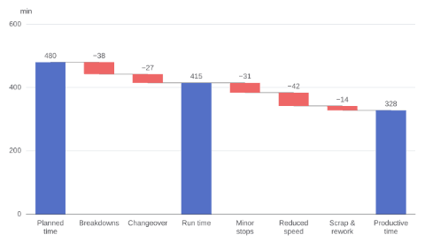

<!-- Generated by web/e2e/wiki.js - do not edit this page. Edit docs/wiki/examples/*.json, docs/wiki/notes/*.md or the generator, then run "npm run wiki" in web/. -->

Bridge chart: a starting total, increases and decreases, subtotals and an end total (OEE losses, energy balance, cost variance).

| | |
|---|---|
| Component id | `open.industrial.Waterfall` |
| Palette | **Open Components / Industrial** → **Waterfall Chart** |
| Default size | 700 × 400 |



*Waterfall Chart as dropped from the palette, showing its built-in sample data.*

This component builds its chart from the domain props below, so there is no ECharts option to write: bind the props to your tags and queries. (A non-empty `option` is an advanced override that replaces the generated chart.)

## How to use it in Ignition

1. In the Designer, drag **Waterfall Chart** from the **Open Components / Industrial** group of the Perspective component palette onto a view. It shows sample data.
2. Select it and replace the sample data in the Property Editor: type values, paste JSON (right-click a property, **Paste**), or add a binding.
3. Bind the data props to tags, tag history or named queries. The props and the shape each one expects are listed under [Props](#props); [Binding examples](#binding-examples) has worked examples.

## Binding examples

`steps` is an ordered list of objects. A step with `"type": "total"` and a `value` sets the opening
total; steps without a type add their `value` (negative for a loss); `"type": "subtotal"` and a closing
`"type": "total"` without a value show the running total.

**Where the shift's time went, from a named query.** The query returns the losses in the order they
should appear:

```sql
SELECT loss_category AS name, SUM(minutes) AS minutes
FROM shift_losses WHERE shift_id = :shift
GROUP BY loss_category ORDER BY MIN(sort_order)
```

Bind it to `props.steps` (Return Format: dataset). The transform adds the opening and closing totals:

```python
def transform(self, value, quality, timestamp):
    steps = [{"name": "Planned time", "value": 480, "type": "total"}]
    for row in range(value.getRowCount()):
        steps.append({
            "name": str(value.getValueAt(row, "name")),
            "value": -abs(value.getValueAt(row, "minutes")),  # losses go down
        })
    steps.append({"name": "Productive time", "type": "total"})
    return steps
```

Replace the fixed `480` with a view parameter or a tag read when the planned time varies. Set `unit` to
the unit of the values (`min`, `kWh`, `EUR`).

**Budget against actual.** The same shape works for a variance bridge: an opening total (`Budget`),
positive and negative deltas, and a closing total (`Actual`). Set `orientation` to `"horizontal"` when
the step names are long.

## Props

| Property | Type | Default | Description |
|---|---|---|---|
| `steps` | array of object | sample data (8 items) | Steps of the bridge, in order, as objects: { name, value, type? }. type "delta" (default) adds value to the running total; "subtotal" shows the running total; "total" shows the running total, or sets it when a value is given (use it for the opening total). Bind to your loss or variance data. |
| `title` | string | `""` | Chart title. Leave blank for no title. |
| `unit` | string | `"min"` | Unit of the values, shown on the value axis and in tooltips. |
| `decimals` | integer | `0` | Decimal places of the value labels and tooltips (0-10). |
| `increaseColor` | string | `"#3ba272"` | Colour of increases (positive deltas). |
| `decreaseColor` | string | `"#ee6666"` | Colour of decreases (negative deltas). |
| `totalColor` | string | `"#5470c6"` | Colour of total and subtotal bars. |
| `showValues` | boolean | `true` | Label each bar with its value; deltas carry a sign. |
| `showConnectors` | boolean | `true` | Draw thin lines carrying the running total from bar to bar. |
| `orientation` | string | `"vertical"` | vertical: bars rise from a category axis at the bottom. horizontal: steps run top to bottom, which suits long step names. One of: `"vertical"`, `"horizontal"`. |
| `startAtZero` | boolean | `true` | Start the value axis at zero. Turn off to zoom in on small changes of a large total; total bars are then cut off at the axis. Ignored when the running total crosses zero. |

The shared props (`theme`, `renderer`, `notMerge`, `lazyUpdate`, `sanitizeTooltip`, ...) and the seven events are the same as on every component: see [Binding Data](Binding-Data), [Themes](Themes) and [Events](Events).
