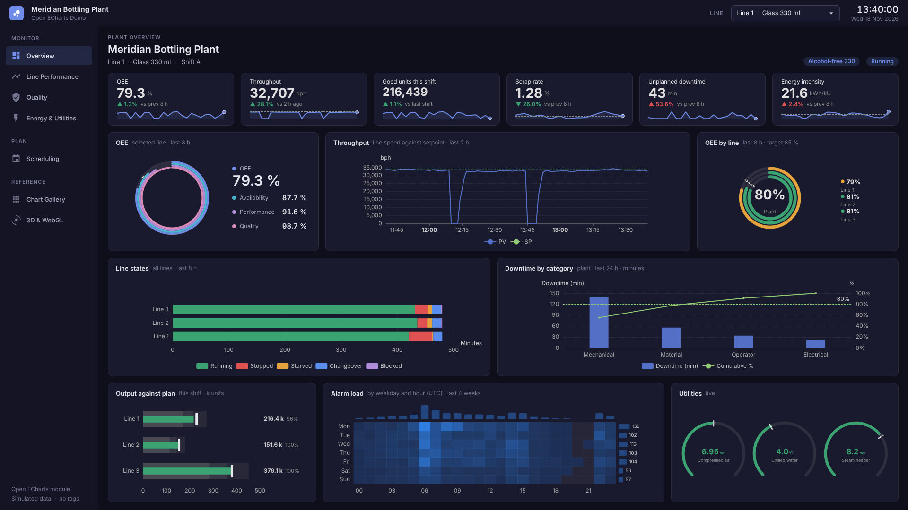

# Open ECharts Demo — Meridian Bottling Plant

A Perspective project that shows the Open ECharts components on a made-up plant: three packaging
lines, utilities and a QA lab. It needs no tags and no database; every number comes from a script
library inside the project.

> **Status.** All seven pages are built, and together they use **every one of the 57 components**
> the Open ECharts module ships (`validate.js` checks this against `components.manifest.json`).
> **The project has not been imported into a gateway yet**: it was written where no
> Ignition was available, from the file formats of public projects
> ([FORMAT-NOTES.md](FORMAT-NOTES.md)). Read "If something does not load" before the first import.



The pictures in `screenshots/` are drawn by `tools/preview.js`, **not by Perspective**. The charts
in them are the real components; the layout around them is an imitation in plain HTML and CSS.

## What is in it

| Page | URL | Components |
|---|---|---|
| Overview | `/` | KPI Tile ×6, OEE Summary, Industrial Trend, Metric Rings, State Timeline, Pareto, Bullet Chart, Event Heatmap, Dial Gauge ×3 |
| Line Performance | `/line` | KPI Tile ×6, OEE Summary, Waterfall, Bullet Chart, Industrial Trend, Pareto, State Timeline, Downtime Tracker |
| Quality | `/quality` | KPI Tile ×6, SPC Chart, Capability Histogram, Radar Comparison, Event Heatmap; Boxplot, Treemap, Heatmap |
| Energy & Utilities | `/energy` | KPI Tile ×6, Flow Diagram, Dial Gauge ×4, Waterfall, Metric Rings, Event Heatmap; Line, Calendar |
| Scheduling | `/schedule` | KPI Tile ×5, Gantt, Bullet Chart, Resource Heatmap, Batch Timeline, Shift Calendar, Schedule Calendar |
| Chart Gallery | `/gallery` | 40 tiles of the generic 2D components, including EChart (any option), Map and Lines on an invented plant floor plan, Graphic (a process mimic), Effect Scatter and Custom |
| 3D & WebGL | `/3d` | all eleven ECharts-GL components: Map 3D and Polygons 3D (the floor plan extruded), Line 3D, Scatter 3D, Bar 3D, Surface, Globe, Lines 3D, Scatter GL, Graph GL, Flow GL |

The maps show an invented floor plan (`tools/pages/floor-plan.js`, GeoJSON in plain metres),
registered through the components' `maps` prop: no geography. The GL charts have a page of their
own because browsers limit the number of WebGL contexts per page.

A header is docked at the top (plant name, line selector, clock) and a navigation rail at the
left. The line selector writes `session.custom.line` (`L1`, `L2`, `L3`); every page reads it.

```text
examples/demo-project/
  project/            the Ignition project (generated by tools/build.js, except the script library)
  dist/OpenEChartsDemo.zip   project/ as an importable archive
  tools/              build, validate, preview, package (Node, nothing to install)
  tags/               optional tag export, for switching from simulated data to tags
  screenshots/        previews (not Perspective)
  FORMAT-NOTES.md     the file formats, their sources, and what is unconfirmed
  CONVENTIONS.md      how to build the remaining pages
```

## Requirements

- Ignition **8.3.7 or newer** with the **Perspective** module.
- The **Open ECharts** module from this repository installed on the gateway
  ([docs/INSTALL.md](../../docs/INSTALL.md)). Without it every chart shows as a missing component.
- Nothing else: no tag provider content, no database connection, no other module.

## Import

Name the project `OpenEChartsDemo`.

**A. REST API** (grounded in two tools that do this against 8.3 gateways; see FORMAT-NOTES.md
section 8). With an API token that may write projects:

```bash
curl -X POST "http://<gateway>:8088/data/api/v1/projects/import/OpenEChartsDemo?overwrite=true" \
     -H "X-Ignition-API-Token: <token>" -H "Content-Type: application/zip" \
     --data-binary @examples/demo-project/dist/OpenEChartsDemo.zip
curl -X POST "http://<gateway>:8088/data/api/v1/scan/projects" -H "X-Ignition-API-Token: <token>"
```

The endpoint paths, the `X-Ignition-API-Token` header, the `application/zip` body and
`overwrite=true` are all taken from those tools; the commands themselves were not run.

**B. Copy the folder** (grounded: a project is a folder under `data/projects/`). Copy
`examples/demo-project/project/` to `<ignition>/data/projects/OpenEChartsDemo/`, then make the
gateway scan its projects (the second `curl` above) or restart it.

**C. Designer or gateway web page** (**not verified**: no source shows the steps, they are from
memory). In the Designer: File > Import, choose `dist/OpenEChartsDemo.zip`. On the gateway web
page of 8.3: the Projects page under Platform has an import action that takes the same zip.

Then open `http://<gateway>:8088/data/perspective/client/OpenEChartsDemo`.

### If something does not load

The likely places, most likely first. FORMAT-NOTES.md section 9 has the full list and a fallback
for each.

| Symptom | Likely cause | Fix |
|---|---|---|
| Pages are empty, charts say "No data" | The `runScript` binding on `view.custom.data` does not deliver an object | In `tools/lib/ui.js` `page()`, switch to the `now(5000)` + script transform form shown in FORMAT-NOTES.md section 4 and rebuild |
| Clicking the navigation does nothing | The `nav` action shape | Replace it in `tools/pages/shell.js` with a script action: `system.perspective.navigate(page = "/line")` |
| No page is highlighted in the navigation | `page.props.path` is not the property name | Look at the page props in the Designer's session property editor and correct the name in `tools/pages/shell.js` |
| Navigation icons are blank | An icon name is not in the `material` library | Pick another name in `PAGES` in `tools/pages/shell.js` |
| Dropdown or scrollbars look light | The session theme `dark` is not applied | Set the session prop `theme` in the Designer |

## How the sample data works

`project/ignition/script-python/demo/data/code.py` is the project library module `demo.data`.

- It models three lines. Each 20-minute block of a line either runs, has one stop (a weighted
  choice of eleven reasons, 2 to 18 minutes), a short starved or blocked gap, or a planned
  changeover. Speed, counts, scrap, OEE, the state timeline, the downtime Pareto and the waterfall
  are all derived from that one model, so the pages agree with each other.
- All randomness is a hash of (name, line, time step). The same line and time always give the same
  numbers, values drift smoothly, trends scroll, and nothing is stored.
- Values move on a 5-second grid. A page view has one binding that polls:

  ```text
  view.custom.data  <-  runScript("demo.data.overview", 5000, {session.custom.line})
  ```

  and its components read parts of the result with property bindings such as
  `view.custom.data.oee.availability`. One script call per page every five seconds, and an
  immediate one when the line changes.
- Times are epoch milliseconds in UTC, and shifts are fixed UTC blocks (06–14, 14–22, 22–06).
- The file runs unchanged on Jython 2.7 and on Python 3. The tools execute this same file with
  `python3`, so the preview and the validator use the numbers the gateway would produce for the
  same instant.

## Switching to real tags

Optional, and independent of the demo: `tags/meridian-demo-tags.json` holds 30 tags (memory tags
and expression tags that move by themselves) under a folder `MeridianDemo`, with one sub-folder
per line (`L1`, `L2`, `L3`) and one for utilities. Import it in the Designer's Tag Browser into the
`default` provider. (The layout of that file is from memory; see FORMAT-NOTES.md section 9.)

To drive a component from a tag, replace its property binding with an indirect tag binding. The
selected line picks the folder:

```json
"props.availability": {
  "binding": {
    "config": {
      "fallbackDelay": 2.5,
      "mode": "indirect",
      "references": { "line": "{session.custom.line}" },
      "tagPath": "[default]MeridianDemo/{line}/Availability"
    },
    "type": "tag"
  }
}
```

Start with single values: OEE factors, KPI `value`, Dial Gauge `value`. For series (Trend,
sparklines, State Timeline) use a Tag History binding or a named query with a script transform;
each component's page in [docs/wiki](../../docs/wiki/Home.md) has a worked example. Views with tag
bindings still validate, with a warning: the tools cannot preview what they cannot evaluate.

Do this in the Designer on a copy of the project. A view edited in the Designer no longer matches
`tools/pages/*.js`; see CONVENTIONS.md, "Two sources".

## Tools

Plain Node scripts. They use Node built-ins, `python3`, and for the preview only: React from
`web/node_modules`, the built bundle in `web/build/generated-resources/mounted` (run
`npm run build` in `web/` if it is missing) and Playwright with Chromium. They install nothing.

| Command | What it does |
|---|---|
| `node examples/demo-project/tools/build.js` | Writes `project/` from `tools/design.js` and `tools/pages/*.js`. `--check` only compares. |
| `node examples/demo-project/tools/validate.js` | Checks every file against FORMAT-NOTES.md: manifests, view structure, component types (and that every component of the module is used somewhere), bindings, style classes, page config; runs the script library for all three lines, resolves every binding and validates each Open ECharts component's props against its prop schema; checks the library stays in the Jython 2.7 / Python 3 subset; checks `project/` and the zip are current. Exit code 1 on any error. |
| `node examples/demo-project/tools/preview.js` | Draws a page to `screenshots/` at 1920×1080 and 1366×768. `--page /line`, `--view Shell/NavRail`, `--size WxH`, `--line L2`, `--full`. |
| `node examples/demo-project/tools/package.js` | Writes `dist/OpenEChartsDemo.zip`. `--check` compares it with `project/`. |

**The preview is an approximation.** It lays out Perspective's flex container, label, icon,
embedded view, dropdown and markdown components with ordinary CSS, turns style classes into CSS,
and resolves bindings once at a fixed time (Wed 18 Nov 2026 13:40 UTC unless `--now` is given).
Perspective's own stylesheet, its theme, fonts, icons, its dropdown and the exact sizing of flex
children are not reproduced. Use it to catch overlaps, cramped cards and weak hierarchy before
importing; do not use it to sign off pixels.

The zip is reproducible (sorted entries, one fixed timestamp, no extra fields): building it twice
gives the same bytes with the same Node version. A different zlib may compress differently, which
is why `validate.js` compares the archive's contents, not its hash.
